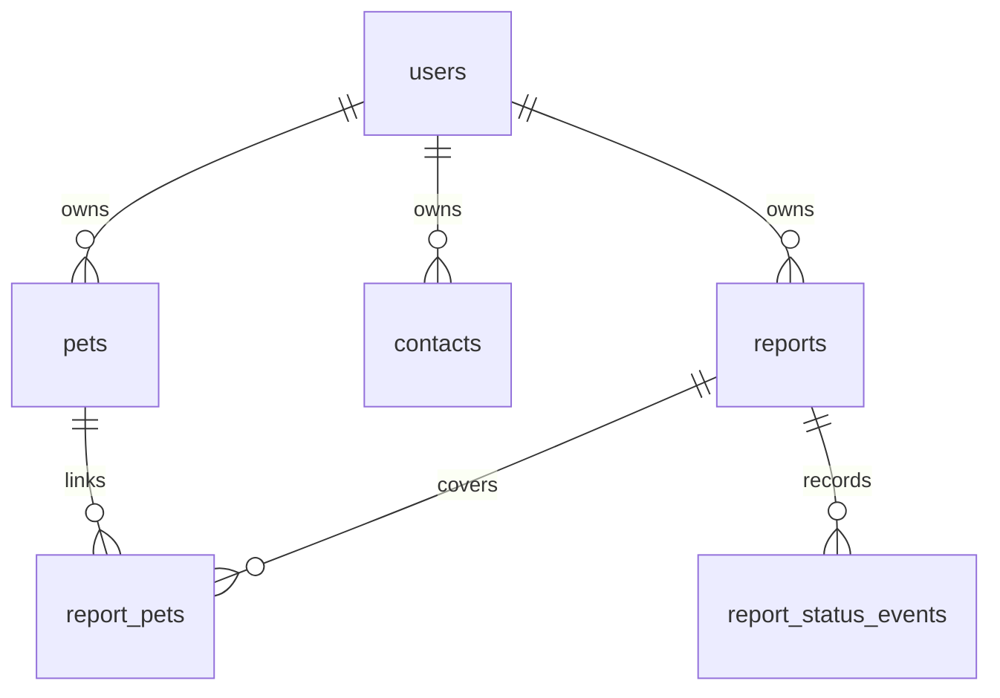
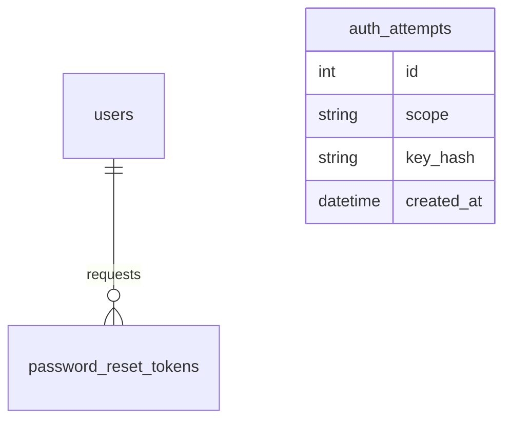

# Architecture and Design

**Phase:** Elaboration | **Status:** Sprint 2 implementation documented; Sprint 3 design implemented on `sprint3/integration`, not merged

**Owner:** _TBD_ | **Baseline:** `4d51cc3`, November 4, 2026

## 1. Scope and structure

Pet Finder is a server-rendered Flask application backed by PostgreSQL. Blueprints
share SQLAlchemy models and Flask-Login session authentication; Jinja templates
extend `base.html`. Vanilla browser scripts supply timezone offsets, clipboard
copying, and printing. There is no separate frontend service, outbound email
service, background reminder worker, or persisted generated-output store.

This describes implemented behavior, not a claim of production or sponsor approval.
See [requirements](../1-inception/requirements-srs.md),
[use cases](use-case-model.md), and the
[Sprint 2 decision log](../project-management/sprint-2-record.md#decision-log).

## 2. Components

| Component | Responsibility / dependencies |
|---|---|
| `app.py` | Application factory, configuration, extension setup, blueprint registration, user loader, init-db CLI |
| `extensions.py` | Shared SQLAlchemy and LoginManager instances |
| `models.py` | User/Pet plus Sprint 2 Contact, Report, ReportPet, ReportStatusEvent |
| `auth.py` | Existing registration/login/logout; login-only stale-pet reminder |
| `pets.py` | Existing owned pet CRUD, photo upload/replacement/deletion |
| `contacts.py` | Owned contact CRUD, grouping, inline validation |
| `reports.py` | Owned reports, selected-pet filtering, UTC normalization, status/history |
| `outputs.py` | On-demand email/phone/social/flyer content; shared owned-contact picker and empty-pets guard |
| `settings.py` | Unmerged UI branch: Settings page and validated display-name updates |
| `templates/` and `static/css/app.css` | Server-rendered screens, shared navigation, output copy/print styles |
| `static/css/material.css`, `static/js/preferences.js` | Unmerged UI branch: Material 3 shell, screen-only dark and larger-text themes, and browser-saved theme, text, and radius preferences |
| `static/uploads/` | Runtime pet photos served by Flask static URLs |

Flask-WTF CSRF protection is initialized for the application. Output GETs are
read-only; mutations use protected form POSTs.

## 3. Data model

The diagram is source maintained inline in this document.

| Table / model | Fields and constraints |
|---|---|
| `users` / User | Integer PK; unique indexed required email varchar(255); password_hash; created_at. Existing table retained. |
| `pets` / Pet | Integer PK; required indexed owner FK; required name/species; optional breed/birth_date/notes/photo_path/photo_uploaded_at; created_at/updated_at. Existing columns retained. |
| `contacts` / Contact | Integer PK; required indexed owner FK; category varchar(50), name varchar(100); phone varchar(30), email varchar(255), notes; created_at/updated_at. |
| `reports` / Report | Integer PK; required indexed owner FK; status varchar(20), default open; optional last_seen_at, location varchar(255), notes; created_at/updated_at/closed_at. Required location is enforced in the form, not a non-null schema constraint. |
| `report_pets` / ReportPet | Integer PK; required indexed report_id and pet_id FKs; created_at. Explicit join model. |
| `report_status_events` / ReportStatusEvent | Integer PK; required indexed report_id FK; nullable from_status, required to_status; changed_at. |

`Report.STATUSES` supplies application values `open/found/closed`; the model does
not declare a database enum/check constraint. Form selection deduplicates pet IDs;
the join model does not declare a unique report/pet pair constraint.
`Report.pets` is a convenience property over link rows, not a second relationship
with an explicit ordering clause.

### Relationship lifecycle

Relationships use ORM `all, delete-orphan` cascades. Deleting a pet through the
ORM removes its report links while retaining reports/history. Deleting a report
removes links and status events while retaining pets. Deleting a user through
the ORM removes their pets, contacts, and reports. FKs do not specify raw-SQL
`ON DELETE CASCADE`; these behaviors must not be assumed for bulk SQL deletion.

A report may have zero remaining pets after deletion. Its detail/history stay
available; all output routes redirect to detail with an explanatory error.

### Schema creation and persistence

`flask init-db` invokes `db.create_all()`. It creates missing tables without
resetting existing data, but does not alter existing columns, run versioned
migrations, or backfill earlier status history. PostgreSQL uses the Compose
`pgdata` volume; image files live separately under `src/static/uploads/`.
Retention, production backups, and recovery objectives remain _TBD_.

On the nearby feed and UI branches, `flask upgrade-community` adds the feed columns
to an older database, keeps existing records, and is safe to run again. On `sprint3/integration`, it also adds `users.full_name`, `users.phone`,
and `users.session_version`, because existing code loads `User` after that command.

## 4. Application interfaces

`<id>` below denotes an integer path ID. All routes in these tables require login.

| Route | Methods | Behavior |
|---|---|---|
| `/contacts` | GET | Owned contacts grouped by category, sorted by name |
| `/contacts/new` | GET, POST | Form / create under current_user.id |
| `/contacts/<id>` | GET | Owned contact detail |
| `/contacts/<id>/edit` | GET, POST | Form / validated update |
| `/contacts/<id>/delete` | GET, POST | Confirmation / deletion |
| `/reports` | GET | Owned reports, newest creation first |
| `/reports/new` | GET, POST | Form / create report, links, initial event; zero-pets redirect; on the UI branch, GET `?pet_id=` preselects an owned pet |
| `/reports/<id>` | GET | Detail, history, status form, output links |
| `/reports/<id>/status` | POST | Validated transition or no-op |
| `/reports/<id>/email` | GET | Owned-contact picker |
| `/reports/<id>/email/<contact_id>` | GET | Subject/body and optional mailto |
| `/reports/<id>/phone-script` | GET | Same picker, phone target |
| `/reports/<id>/phone-script/<contact_id>` | GET | Phone script and number/fallback |
| `/reports/<id>/social-post` | GET | Caption and photo download links |
| `/reports/<id>/flyer` | GET | Printable flyer with notes excerpt |
| `/settings` | GET, POST | Unmerged UI branch: preferences page / display-name update |

Existing `/register` and `/login` are GET/POST; `/logout` is a protected POST.
Existing pet CRUD remains under `/pets`. There is no new application root route
or report edit/delete route in this increment.

## 5. Validation and time

Contacts require category/name and at least phone or email. The validator enforces
50/100-character category/name limits, email format and 255-character limit, and a
7–30-character phone format containing at least one digit. Categories are suggested,
not an enum. Validation is shared by create/edit; invalid forms redisplay errors.

Report location is required and at most 255 characters. Selected IDs are parsed
and deduplicated, then filtered by Pet.owner_id. No matching owned pet is an error.
In the delivered parser, a non-integer selection causes the requested-ID set to
be discarded; it is not silently accepted.

The optional datetime-local value is parsed to a naive datetime. The browser
calculates the selected date's `getTimezoneOffset()` on initial render, input,
change, and submit. The server adds that `UTC - local` minute offset and validates
against `datetime.utcnow()` before storage. Bounds are inclusive `[-840,720]`;
out-of-range numeric values yield a field error. Missing/non-numeric offsets
become zero. This maintains the existing naive-UTC timestamp convention;
a timezone ID is not stored. Report detail labels the last-seen value UTC.

## 6. Status and outputs

Creating a report adds an initial `None -> open` status event. Each actual change
adds a from/to event and updates the report in one transaction. History is ordered
by changed_at. Entering closed sets closed_at to UTC now; leaving closed clears it.
Same-status submissions and invalid values do not create events or update report
timestamps. This is status history, not a general-purpose field/actor audit log.

Email and phone select an owned contact independently of owned-report lookup.
They share `pick_contact.html`. All generated text is assembled from current
data and not persisted. Native mailto opens a user's email client; it is not sending
through an application mail backend. Social/flyer require no contact.

Flyer chooses the first linked pet with a nonempty photo path, uses deduplicated
sorted species, and limits only the notes display to 200 characters including an
ellipsis when shortened. No stored notes are changed. Email/phone/social/detail
retain full notes. Print CSS hides the header/navigation, flashes, and no-print
controls. The browser handles printing; no server PDF service is added.

## 7. Authentication, authorization, and media

- Owner lookups filter by current_user.id; server-assigned owner IDs ignore forged form values.
- Report/contact combinations are independently checked for email and phone output.
- Foreign/missing records return 404 to authenticated users; protected pages redirect
  anonymous requests to login.
- Flask-WTF validates POST tokens; generated-output routes are GET-only.
- Jinja escapes user content in templates. This does not establish exhaustive
  security certification or a production configuration.
- On `main`, uploaded photos retain inherited public static URLs and route
  authorization does not provide private image delivery. On the Sprint 3 branch, they
  are access-checked, and TC-107 passed on November 22, 2026; see [section 10](#10-sprint-3-design).

The successful-login reminder queries only owned pets with
`updated_at < utcnow - timedelta(days=90)`. It emits one sorted info flash with
singular/plural grammar; exactly 90 days is excluded. No scheduled job or new
reminder table/acknowledgement state is introduced.

## 8. Technology and deployment

| Layer | Implemented choice |
|---|---|
| Container runtime | Python 3.12-slim application image |
| Web/templates | Flask 3.0.3 / Jinja via Flask |
| Persistence | Flask-SQLAlchemy 3.1.1 / PostgreSQL 16 / psycopg2-binary 2.9.9 |
| Session login | Flask-Login 0.6.3 |
| Form CSRF | Flask-WTF 1.2.1 |
| Browser integration | Vanilla JavaScript, clipboard/download/mailto/print |
| Development stack | Docker Compose, app port 5000, database port 5432 |

See [maintenance](../4-transition/maintenance-manual.md) for reproducible setup
and operational limits. Production architecture and supported browser matrix are
_TBD_; dependency versions above are repository pins, not a claim of latest releases.

## 9. Decisions and traceability

The canonical decision rationale is S2-D01 through S2-D14 in the
[Sprint 2 record](../project-management/sprint-2-record.md#decision-log).
Source/model relationships implement FR-S2-01 through FR-S2-09; the
[SRS traceability table](../1-inception/requirements-srs.md#6-acceptance-and-traceability)
maps each to design and tests. Review history and actual verification limits are
in the [test plan](../3-construction/test-plan.md).

## 10. Sprint 3 design

This design is implemented on `sprint3/integration`, not merged. It follows the Sprint 3 build
contract. All 180 automated tests passed, and 22 of 27 official
Sprint 3 test cases passed on November 22, 2026. It has not been deployed.

### New modules

| Module | Responsibility |
|---|---|
| `src/mailer.py` | `send_email(to, subject, body)` through the configured mail backend |
| `src/rate_limit.py` | `AuthAttempt` counting for sign-in and reset requests |
| `src/sprint3_schema.py` | `flask upgrade-sprint3` CLI command |

### Added columns

All are nullable except `users.session_version`. `microchip_status` defaults to `unknown`.

| Table | Columns |
|---|---|
| `pets` | `sex` varchar(20), `height_inches` float, `weight_lbs` float, `colors` varchar(100), `markings` varchar(255), `microchip_status` varchar(20), `microchip_number` varchar(15) |
| `contacts` | `address` varchar(255) |
| `users` | `full_name` varchar(100), `phone` varchar(30), `session_version` integer, not null, default 1 |

`Pet.age_display` is a read-only property. It returns `None` with no birth date, or
`Under 1 month`, `N month(s)`, `N year(s)`, or `N year(s), M month(s)` from today's date.

### New tables

| Table / model | Fields and constraints |
|---|---|
| `password_reset_tokens` / PasswordResetToken | `id`; indexed `user_id` FK; unique `token_hash` varchar(64); `expires_at`; `used_at`; `created_at` |
| `auth_attempts` / AuthAttempt | `id`; `scope` varchar(20); indexed `key_hash` varchar(64); indexed `created_at`. No user FK. |

### Routes

| Route | Methods | Access | Behavior |
|---|---|---|---|
| `/settings` | GET, POST | Login | Accepts `display_name`, `full_name`, `phone`, `email`, and `current_password`. A POST that omits `email` is not an email change |
| `/forgot-password` (`auth.forgot_password`) | GET, POST | Public | Field `email`; same response for known and unknown emails |
| `/reset-password/<token>` (`auth.reset_password`) | GET, POST | Reset link | Fields `password` and `confirm_password`; invalid, expired, or used link returns 400 |

### Password reset

Tokens come from `secrets.token_urlsafe(32)`. Only the SHA-256 hex digest is stored. The
lifetime is `PASSWORD_RESET_TTL_MINUTES`, default 60. A new request invalidates earlier
unused tokens. A successful email change or password reset invalidates all of that user's
unused tokens. A successful reset also updates the password, marks the token used, clears
login attempts for that email and the current client address, increments
`session_version`, and redirects to login.

Emailed links are built from `APP_BASE_URL` when it is set. If it is unset, the request
host is used only when `app.debug` or `app.testing` is true. Otherwise nothing is sent, an
error is logged without the token, and the user sees the generic message.

### Session version

`User.get_id()` returns `<id>:<session_version>`. The user loader accepts that format and
rejects a version mismatch. A legacy session containing only `<id>` counts as version 1.

### Mail backends

| `MAIL_BACKEND` | Behavior |
|---|---|
| `console` (default) | Prints the message only when `app.debug` or `app.testing` is true. Otherwise prints nothing, logs an error without message content, and counts as a failed send |
| `memory` | Appends `to`, `subject`, and `body` to `current_app.extensions["mail_outbox"]` |
| `smtp` | Sends through `smtplib` using `MAIL_HOST`, `MAIL_PORT`, `MAIL_USERNAME`, `MAIL_PASSWORD`, `MAIL_FROM`, and `MAIL_USE_TLS` |

A send failure is logged without the token, and the user still sees the generic message.
The production provider and sending address are _TBD_.

### Request limits

Keys are SHA-256 hashes of the email plus `request.remote_addr`. Forwarded headers are
not trusted.

| Scope | Default limit | Counts | Over limit |
|---|---|---|---|
| `login` | `LOGIN_LIMIT=5` in `LOGIN_WINDOW_SECONDS=900` | Failed logins; a successful login or password reset clears the key | Failures 1-5 return the normal error. The 6th attempt returns status 429 with `Too many attempts. Try again later.`, even with a correct password, because the password is not checked |
| `reset` | `RESET_LIMIT=3` in `RESET_WINDOW_SECONDS=3600` | Every reset request | Same page and status 200; no email sent |

### Redirects and photo access

Login accepts only a same-site relative `next` path. It rejects absolute URLs, `//host`,
backslashes, and control characters, then falls back to `pets.list_pets`. Registration
keeps its visible duplicate-email error because TC-002 requires it.

On `main`, uploaded photo URLs are directly accessible. On the Sprint 3 branch, they are
access-checked, and TC-107 passed on November 22, 2026. The owner can always open their current photo. A non-owner
can open it only when it belongs to a report that is shared and has status `open`. On a
resolved shared report, non-owners see `Photo unavailable because this report is resolved.`

Every static request that resolves inside `uploads/` gets this check against its
normalized path, however the URL is written. That includes `/static/./uploads/<file>`,
`/static/x/../uploads/<file>`, `/static/%2e/uploads/<file>`,
`/static/x/%2e%2e/uploads/<file>`, and backslash or repeated-slash forms. Other static
assets keep working.

### Form error association

The report form's `pet_ids` checkboxes are one control, so `aria-describedby` on their
enclosing `fieldset` satisfies the field-error rule.

### Schema upgrade

`flask upgrade-community` adds the three `users` columns noted in section 3.
`flask upgrade-sprint3` makes all other Sprint 3 schema changes, keeps `session_version`
at default 1 for existing users, keeps all records, and is designed to be safe to run twice on PostgreSQL and SQLite. Run it after `flask init-db`
and `flask upgrade-community`. See the
[maintenance manual](../4-transition/maintenance-manual.md#9-sprint-3-upgrade-and-operations).

## Revision history

| Date | Author | Summary |
|---|---|---|
| _TBD_ | _TBD_ | Initial draft template |
| 2026-11-04 | Codex | Document implemented Sprint 2 components, schema, routes, lifecycle, security, UTC rules, and decisions. |
| 2026-11-21 | Claude | Add Material 3 UI components, Settings route, report preselect, and the community upgrade command for the unmerged UI branch. |
| 2026-11-21 | Claude | Add Sprint 3 fields, tables, modules, routes, mail backends, limits, and upgrade command, implemented on `sprint3/integration`, not merged. |
| 2026-11-21 | Claude | Apply contract Addenda A and B: reset link, console mail, token, session, and shared photo design, implemented on `sprint3/integration`, not merged. |
| 2026-11-21 | Claude | Apply integration corrections and contract Addenda C and D: upgrade columns, sixth-attempt limit, photo path guard, and fieldset errors, implemented on `sprint3/integration`, not merged. |
| 2026-11-22 | Claude | Replace pending Sprint 3 status with recorded automated, QA, and owner-check evidence. |
| 2026-11-22 | Claude | Record the official Sprint 3 run: 22 Pass and 5 Not run, with the 390 px heading overflow fixed. |
